<div align="center">

# n8n-clay-hiring-velocity-target-account-radar

**Outbound growth radar that monitors target account job board listings and LinkedIn hiring spikes via Clay and Apollo, identifying organizational expansion and routing warm alerts to sales development reps.**

A dhRobin Systems Revenue Infrastructure blueprint

     

</div>

---

## Table of Contents

1. [Overview](#1-overview)
2. [Architecture](#2-architecture)
3. [Repository Contents](#3-repository-contents)
4. [Prerequisites](#4-prerequisites)
5. [5-Minute Sandbox Quick Start](#5-5-minute-sandbox-quick-start)
6. [Environment Variables](#6-environment-variables)
7. [Node-by-Node Configuration Guide](#7-node-by-node-configuration-guide)
8. [Scoring Model](#8-scoring-model)
9. [Safety Matrix](#9-safety-matrix)
10. [Data Protection and Compliance](#10-data-protection-and-compliance)
11. [Deployment and Promotion Path](#11-deployment-and-promotion-path)
12. [Operations and Troubleshooting](#12-operations-and-troubleshooting)
13. [Extending the Radar](#13-extending-the-radar)
14. [Disclaimer and License](#14-disclaimer-and-license)

---

## 1. Overview

A company that adds 40% to its engineering team in a month, or opens eight sales roles in two weeks, is changing how it operates. Budgets are moving, new leaders are arriving and new tooling decisions are coming. I built this radar to catch that moment across a target account list every morning and put it in front of the SDR who owns the account, with the evidence attached.

**On every scheduled run, the radar:**

1. **Loads the target account scope** from HubSpot (CRM Search, paginated) or Google Sheets, with each account's stored rolling baseline.
2. **Normalises and filters** domains: it removes duplicates, invalid, consumer and reserved domains, and skips accounts scanned too recently.
3. **Collects hiring intelligence** from Apollo.io (organization enrichment, departmental headcount, job postings) and/or a Clay endpoint (job board listings, headcount by department, growth).
4. **Scores hiring velocity**: it classifies open roles by department, measures department headcount growth against the rolling baseline, and evaluates spike thresholds (by default **≥ 30% department growth** or **more than 5 open roles** in target departments).
5. **Routes** the result: it writes radar properties to every HubSpot company, creates high-intent SDR tasks for accounts heating up, and posts one Slack Block Kit digest.

**Design principles**

| Principle | Implementation |
|---|---|
| Safe by default | With no environment variables, the radar makes **zero external API calls and zero CRM writes**. |
| Secrets stay out of data | Every key and webhook URL is referenced only as `{{ $env.* }}` in an HTTP header, query or URL field. No secret is assigned in a Set or Code node. |
| Explainable scores | Every score carries its components, triggers, metrics and a human-readable summary. Each suppressed alert records why. |
| Noise control | Thresholds, minimum department baselines, an alert tier floor and a per-account cooldown keep SDR queues focused. |
| Batch-first writes | One HubSpot batch update, one task batch and one Slack message per run, regardless of account count. |
| Company-level data only | No person-level records are requested from any provider. |

---

## 2. Architecture

```mermaid
flowchart LR
    T1[Daily Radar Schedule<br/>0 6 * * 1-5] --> CFG
    T2[Manual Test Trigger] --> CFG
    CFG[Config & Safety Gate<br/>$env → config.*] --> SB{Sandbox Mode?}
    SB -- yes --> MS[Mock Target<br/>Account Scope]
    SB -- no --> SRC{Scope From<br/>HubSpot?}
    SRC -- yes --> HS[HubSpot: Search<br/>Target Accounts<br/>paginated] --> FH[Flatten HubSpot Scope]
    SRC -- no --> GS[Google Sheets: Read<br/>Target Accounts] --> PS[Parse Sheet Scope]
    MS --> NT[Normalize Target<br/>Accounts]
    FH --> NT
    PS --> NT
    NT --> HA{Has Accounts?}
    HA -- no --> NA[No Accounts: End]
    HA -- yes --> HL{Hiring Live?}
    HL -- no --> MH[Mock Hiring<br/>Intelligence]
    HL -- yes --> AE{Apollo Enabled?}
    AE -- yes --> AO[Apollo: Enrich<br/>Organization] --> AJ[Apollo: Job Postings] --> AA[Attach Apollo Signals]
    AE -- no --> SA[Skip Apollo]
    AA --> CE{Clay Enabled?}
    SA --> CE
    CE -- yes --> CL[Clay: Hiring Lookup] --> AC[Attach Clay Signals]
    CE -- no --> SC[Skip Clay]
    AC --> SH
    SC --> SH
    MH --> SH[Score Hiring Velocity]
    SH --> CP[Compose Sync &<br/>Alert Payloads]
    CP --> DR{Dry Run?}
    DR -- yes --> PV[Dry Run:<br/>Radar Preview]
    DR -- no --> SY{Sync to HubSpot?} --> BU[HubSpot: Batch<br/>Update Companies] --> CT{Create SDR<br/>Tasks?} --> BT[HubSpot: Batch<br/>Create SDR Tasks]
    DR -- no --> NS{Notify Slack?} --> SL[Slack: Post<br/>Radar Digest]
```



### Why the providers run as gated stages

The architecture calls for parallel integration queries. In n8n's `v1` execution order, a node fed by two parallel branches runs once per branch, which would double-score every account. I therefore run Apollo and Clay as **independently gated stages in sequence**. Each gate is decided once per run from configuration, so every downstream node executes exactly once, and a disabled provider is a pass-through. Inside each stage, HTTP requests are batched and rate-limited per account.

### Stage contracts

| Stage | Output |
|---|---|
| Scope adapters (mock / HubSpot / Sheets) | One item: `{ source, pagesFetched, accounts: [{ companyId, name, domain, employees, ownerId, baselineJson, lastScannedAt, lastAlertedAt, tier }] }` |
| Normalize Target Accounts | One item per account: `{ companyId, name, domain, employees, ownerId, baseline, lastAlertedAt, previousTier, scopeStats }` |
| Attach / Skip / Mock signals | `{ …account, apollo: Signal \| null, clay: Signal \| null }` where `Signal = { provider, employees, growth6mPct, deptHeadcount, jobs[], error }` |
| Score Hiring Velocity | `{ score, tier, triggers[], alert, alertSuppressedReason, components, metrics, summary, sampleRoles[], nextBaseline }` |
| Compose Sync & Alert Payloads | One item: `{ counts, scope, hubspotBatchUpdate, hubspotTaskBatch, slackPayload, accounts[] }` |

---

## 3. Repository Contents

```
n8n-clay-hiring-velocity-target-account-radar/
├── README.md        Technical documentation (this file)
├── workflow.json    Importable n8n workflow with sticky notes and pinned synthetic payloads
├── DISCLAIMER.md    Liability limitation and usage terms
└── LICENSE          MIT License
```

---

## 4. Prerequisites

| Requirement | Detail |
|---|---|
| n8n | Self-hosted **1.60 or later** (Schedule Trigger 1.2, Set 3.4, IF 2, Code 2, HTTP Request 4.2, `v1` execution order). |
| Env access | `N8N_BLOCK_ENV_ACCESS_IN_NODE=false`. Recent n8n releases block `$env` in nodes by default, so set this explicitly. |
| HubSpot | A private app token with `crm.objects.companies.read`, `crm.objects.companies.write`, and the write scope HubSpot lists for the Tasks API on your account. Start with a developer test account. |
| HubSpot properties | Eight custom company properties (see [§7.4](#74-hubspot-custom-company-properties)). |
| Apollo.io (optional) | API key with access to organization enrichment and organization job postings. Some Apollo endpoints require a master API key and consume credits, so check your plan. |
| Clay (optional) | A Clay table or workflow you expose as an HTTP endpoint that returns the contract in [§7.11](#711-clay-hiring-lookup), plus the key it expects. |
| Google Sheets (optional) | A sheet ID and an API key restricted to the Sheets API (the sheet must be readable by that key). |
| Slack (optional) | Incoming webhook URL for the SDR alerts channel. |

> **n8n Cloud:** you can't define your own environment variables on n8n Cloud. Replace each `$env.X` with `$vars.X` (on plans with Variables) or move the secret into an n8n credential. The node logic is unchanged.

---

## 5. 5-Minute Sandbox Quick Start

1. **Run n8n locally:**
   ```bash
   docker run -it --rm -p 5678:5678 \
     -e N8N_BLOCK_ENV_ACCESS_IN_NODE=false \
     -e GENERIC_TIMEZONE=UTC \
     -v n8n_data:/home/node/.n8n \
     docker.n8n.io/n8nio/n8n
   ```
2. **Import** `workflow.json` (*Workflows → Import from File*).
3. Click **Test workflow** on *Manual Test Trigger*.
4. Open **Dry Run: Radar Preview** and inspect `accounts`, `counts`, `hubspotBatchUpdate`, `hubspotTaskBatch` and `slackPayload`.

**What you should see** (synthetic data, no credentials, nothing sent):

| Account | Score | Tier | Why |
|---|---:|---|---|
| Apex Dynamics Inc | ~92 | hot | Engineering +40% vs. baseline, 11 open Engineering/Sales roles |
| Brightline Robotics Ltd | ~51 | warm | 7 open roles, most of them in Sales |
| Driftwood Health Systems | ~30 | warm | First scan; Apollo 6-month headcount growth +22% |
| Cobalt Ridge Analytics | ~4 | cool | No trigger; alert suppressed with `no_trigger` |

*Normalize Target Accounts* also reports one **duplicate** and one **invalid domain** removed from the six synthetic scope rows.

---

## 6. Environment Variables

All variables are optional. Unset values resolve to the safest behaviour.

### 6.1 Safety gate

| Variable | Default | Behaviour |
|---|---|---|
| `SANDBOX_MODE` | `true` | Any value except `false` forces mock scope and mock hiring data. Zero external calls. |
| `DRY_RUN` | `true` | Any value except `false` stops at *Dry Run: Radar Preview*. |
| `SYNC_TO_HUBSPOT` | `false` | Must be exactly `true` (with `DRY_RUN=false`) to write company properties. |
| `CREATE_SDR_TASKS` | `true` | Effective only when `SYNC_TO_HUBSPOT=true`. Set `false` to update properties without creating tasks. |
| `NOTIFY_SLACK` | `false` | Must be exactly `true` (with `DRY_RUN=false`) to post the digest. |
| `HIRING_PROVIDERS` | `apollo` | Comma-separated: `apollo`, `clay`. Ignored while `SANDBOX_MODE` is on. |

### 6.2 Secrets (HTTP header, query or URL fields only)

| Variable | Used by | Placement |
|---|---|---|
| `HUBSPOT_PRIVATE_APP_TOKEN` | HubSpot search, batch update, task batch | `Authorization: Bearer …` |
| `APOLLO_API_KEY` | Apollo: Enrich Organization, Apollo: Job Postings | `X-Api-Key` header |
| `CLAY_API_KEY` | Clay: Hiring Lookup | `Authorization: Bearer …` |
| `CLAY_HIRING_ENDPOINT_URL` | Clay: Hiring Lookup | URL field (treated as a secret) |
| `GOOGLE_SHEETS_API_KEY` | Google Sheets: Read Target Accounts | `key` query parameter |
| `GOOGLE_SHEET_ID` | Google Sheets: Read Target Accounts | URL field |
| `SLACK_WEBHOOK_URL` | Slack: Post Radar Digest | URL field |

### 6.3 Scope

| Variable | Default | Description |
|---|---|---|
| `SCOPE_SOURCE` | `hubspot` | `hubspot` or `google_sheets`. |
| `SCOPE_FILTER_PROPERTY` | `hs_is_target_account` | HubSpot company property used to select target accounts. |
| `SCOPE_FILTER_VALUE` | `true` | Value matched with `EQ`. |
| `GOOGLE_SHEET_RANGE` | `Targets!A1:I1000` | A1 range including the header row. |
| `MAX_ACCOUNTS_PER_RUN` | `50` | 1–100 (the HubSpot batch limit). |
| `MIN_RESCAN_HOURS` | `20` | Skips accounts scanned more recently. |
| `HUBSPOT_PORTAL_ID` | *(empty)* | Enables *Open in HubSpot* buttons in Slack. Not a secret. |

### 6.4 Scoring

| Variable | Default | Description |
|---|---|---|
| `TARGET_DEPARTMENTS` | `Engineering,Sales` | From: Engineering, Sales, Marketing, Customer Success, Product, Data, Operations, Finance, People. |
| `DEPT_GROWTH_THRESHOLD_PCT` | `30` | Department headcount growth vs. baseline that fires `dept_surge`. |
| `OPEN_ROLES_THRESHOLD` | `5` | Open target-department roles; **more than** this fires `open_roles_spike`. |
| `TOTAL_GROWTH_THRESHOLD_PCT` | `15` | Total headcount growth that fires `headcount_surge`. |
| `MIN_DEPT_BASELINE` | `5` | Departments smaller than this at baseline are ignored for growth (small-number noise). |
| `JOB_LOOKBACK_DAYS` | `30` | Postings older than this are ignored. |
| `BASELINE_WINDOW_DAYS` | `30` | The baseline rolls forward only when it is older than this. |
| `ALERT_MIN_TIER` | `warm` | `warm` or `hot`. |
| `ALERT_COOLDOWN_DAYS` | `14` | No repeat alert or task for an account within this window. |
| `TASK_DUE_HOURS` | `24` | Task due time from creation. |
| `SDR_DEFAULT_OWNER_ID` | *(empty)* | HubSpot owner ID used when a company has no owner. |

### 6.5 Endpoints

| Variable | Default |
|---|---|
| `HUBSPOT_API_BASE_URL` | `https://api.hubapi.com` |
| `HUBSPOT_UI_BASE_URL` | `https://app.hubspot.com` (`https://app-eu1.hubspot.com` for EU portals) |
| `APOLLO_API_BASE_URL` | `https://api.apollo.io` |

### 6.6 Sample `.env` (staging)

```dotenv
# n8n runtime
N8N_BLOCK_ENV_ACCESS_IN_NODE=false
GENERIC_TIMEZONE=UTC

# Safety gate: live data from a HubSpot test portal, nothing written yet
SANDBOX_MODE=false
DRY_RUN=true
SYNC_TO_HUBSPOT=false
CREATE_SDR_TASKS=true
NOTIFY_SLACK=false
HIRING_PROVIDERS=apollo,clay

# Secrets (inject from your secret manager; never commit)
HUBSPOT_PRIVATE_APP_TOKEN=replace-with-test-portal-token
APOLLO_API_KEY=replace-with-apollo-key
CLAY_API_KEY=replace-with-clay-key
CLAY_HIRING_ENDPOINT_URL=https://clay-endpoint.example/hiring-lookup
SLACK_WEBHOOK_URL=https://hooks.slack.example/services/REPLACE/ME

# Scope
SCOPE_SOURCE=hubspot
SCOPE_FILTER_PROPERTY=hs_is_target_account
SCOPE_FILTER_VALUE=true
MAX_ACCOUNTS_PER_RUN=50
HUBSPOT_PORTAL_ID=99000001

# Scoring
TARGET_DEPARTMENTS=Engineering,Sales
DEPT_GROWTH_THRESHOLD_PCT=30
OPEN_ROLES_THRESHOLD=5
ALERT_MIN_TIER=warm
ALERT_COOLDOWN_DAYS=14
```

---

## 7. Node-by-Node Configuration Guide

### 7.1 Daily Radar Schedule / Manual Test Trigger
- Cron `0 6 * * 1-5` (weekdays 06:00 in the workflow timezone). Use `0 6 * * 1` for a weekly radar.
- The workflow imports as **inactive**. Activate it only after completing the promotion path in [§11.2](#112-promotion-path).
- **Pinned:** a synthetic schedule event.

### 7.2 Config & Safety Gate
- **Type:** Set v3.4. Typed, non-secret configuration under `config.*`.
- **Effective flags:** `useApollo`, `useClay` and `hiringLive` are all `false` while `SANDBOX_MODE` is on. `createSdrTasks` is `true` only when `SYNC_TO_HUBSPOT=true` and `CREATE_SDR_TASKS` is not `false`.
- **Fail-safe parsing:** safety flags stay on unless set to exactly `false`, write flags stay off unless set to exactly `true`, and numbers are clamped to safe ranges.

### 7.3 HubSpot: Search Target Accounts
- `POST /crm/v3/objects/companies/search`, filter `SCOPE_FILTER_PROPERTY EQ SCOPE_FILTER_VALUE`, sorted by `hs_object_id`, 100 per page.
- **Pagination:** `after` cursor in the body, 300 ms between pages, at most 20 pages (2,000 accounts; `MAX_ACCOUNTS_PER_RUN` then caps the scan).
- **Properties read:** `name`, `domain`, `website`, `numberofemployees`, `hubspot_owner_id` and the five `hiring_*` state properties.
- **Pinned:** one page of four synthetic accounts.

### 7.4 HubSpot custom company properties
Create these under *Settings → Properties → Company properties* (group suggestion: *Hiring Radar*):

| Internal name | Field type | Written as |
|---|---|---|
| `hiring_velocity_score` | Number | 0–100 |
| `hiring_velocity_tier` | Dropdown: `hot`, `warm`, `cool` | Tier |
| `hiring_open_roles_target` | Number | Open roles in target departments |
| `hiring_open_roles_total` | Number | All open roles in the lookback window |
| `hiring_signal_summary` | Multi-line text | Human-readable summary and triggers |
| `hiring_dept_headcount_json` | Multi-line text | Rolling baseline JSON (`capturedAt`, `employees`, `departments`, `openRolesTarget`) |
| `hiring_last_scanned_at` | Date and time | Scan timestamp |
| `hiring_last_alerted_at` | Date and time | Last alert timestamp (drives the cooldown) |

With these properties you can build active lists such as *tier = hot and owner = me* without touching Slack.

### 7.5 Google Sheets: Read Target Accounts → Parse Sheet Scope
- `GET https://sheets.googleapis.com/v4/spreadsheets/{GOOGLE_SHEET_ID}/values/{range}?key={GOOGLE_SHEETS_API_KEY}`.
- **Header row (case-insensitive):** `company_name`, `domain`, `employees`, `hubspot_company_id`, `owner_id`, `baseline_json`, `last_scanned_at`, `last_alerted_at`, `tier`.
- Rows **without** `hubspot_company_id` are scored and appear in Slack but are never synced. The radar does not write back to the sheet, so baselines for sheet-only rows must be maintained there.
- **Pinned:** a synthetic four-row sheet.

### 7.6 Normalize Target Accounts
| Step | Rule |
|---|---|
| Domain normalisation | Lower-case; strips scheme, path, query, port, trailing dot, `www`/`www2`, and email local parts. Falls back to `website`. |
| Validation | RFC-style labels, 4–253 characters, alphabetic or IDN TLD. |
| Exclusions | Consumer free-mail domains; reserved TLDs (`.test`, `.invalid`, `.local`, …); `.example` in production executions only. |
| De-duplication | By normalised domain (the first record wins). |
| Rescan guard | Skips accounts with `hiring_last_scanned_at` within `MIN_RESCAN_HOURS` (not applied in sandbox). |
| Cap | `MAX_ACCOUNTS_PER_RUN`. |

All counts are reported in `scopeStats`.

### 7.7 Hiring Live? / Apollo Enabled? / Clay Enabled?
These are global gates (see [§2](#why-the-providers-run-as-gated-stages)). A disabled provider passes through as `null` and the scorer uses whatever signals exist.

### 7.8 Apollo: Enrich Organization
- `GET {APOLLO_API_BASE_URL}/api/v1/organizations/enrich?domain={domain}`, header `X-Api-Key: {{ $env.APOLLO_API_KEY }}`.
- Fields used: `organization.id`, `estimated_num_employees`, `departmental_head_count`, `organization_headcount_six_month_growth` and `organization_headcount_twelve_month_growth`.
- One request every 600 ms, 3 retries, **continue on error**. A failed account records `providerErrors` and is still scored on the remaining data.
- **Pinned:** four synthetic organizations.

### 7.9 Apollo: Job Postings
- `GET {APOLLO_API_BASE_URL}/api/v1/organizations/{organization.id}/job_postings?page=1&per_page=100`.
- Fields used: `title`, `url`, `city`, `state`, `country`, `posted_at` and `last_seen_at`.
- If enrichment did not resolve an ID, the request targets `unresolved`, fails softly, and is recorded as a provider error.
- **Pinned:** four synthetic posting sets.

### 7.10 Attach Apollo Signals
This node maps Apollo department keys to radar departments: `engineering`/`information_technology` → Engineering, `sales`/`business_development` → Sales, `support` → Customer Success, `product_management`/`arts_and_design` → Product, `data_science` → Data, `finance`/`accounting` → Finance, `human_resources` → People, plus Marketing and Operations directly. Growth fractions are converted to percentages.

### 7.11 Clay: Hiring Lookup
Clay doesn't publish a single, universal synchronous "hiring" API. Clay data is shaped inside your own tables and workflows. This node calls **your** Clay-backed endpoint, configured in `CLAY_HIRING_ENDPOINT_URL` (for example a Clay table exposed through an HTTP API integration, or a thin service in front of your Clay workspace). Confirm the exact endpoint and authentication method in your Clay workspace before go-live.

**Request** (`POST`, `Authorization: Bearer {{ $env.CLAY_API_KEY }}`):
```json
{ "domain": "apex-dynamics.example", "company_name": "Apex Dynamics Inc", "target_departments": ["Engineering", "Sales"], "lookback_days": 30 }
```

**Response contract:**
```json
{
  "domain": "apex-dynamics.example",
  "jobs": [
    { "title": "QA Automation Engineer", "department": "Engineering", "posted_at": "2026-11-14", "location": "Austin, Texas, United States", "url": "https://jobs.board.example/apex-dynamics/3000", "source": "job_board" }
  ],
  "headcount": { "total": 910, "by_department": { "Engineering": 166, "Sales": 70 } },
  "headcount_growth_90d_pct": 12.4
}
```
The adapter also accepts `open_roles` or `data.jobs` for the job list, `employee_count` for the total, `departments` for department counts, and `growth_pct` for growth. `department` is optional, because titles are classified when it is missing. One request per second, continue on error. **Pinned:** four synthetic responses.

### 7.12 Mock Hiring Intelligence
This node generates offline, fictitious Apollo- and Clay-shaped signals for the four sandbox profiles (hot, warm, first scan, cool).

### 7.13 Score Hiring Velocity
See [§8](#8-scoring-model). Each output carries `score`, `tier`, `triggers`, `alert`, `alertSuppressedReason` (`no_trigger`, `below_alert_tier` or `cooldown`), `components`, `metrics`, `summary`, up to five `sampleRoles`, and `nextBaseline`.

### 7.14 Compose Sync & Alert Payloads
| Payload | Content |
|---|---|
| `hubspotBatchUpdate.inputs[]` | All eight radar properties for every scanned account with a `companyId` (`hiring_last_alerted_at` only when alerted). |
| `hubspotTaskBatch.inputs[]` | One task per alerted account: subject `🔥 Hiring surge: {name} (score N)`, HTML body with triggers, summary and recent roles, `HIGH` priority for hot and `MEDIUM` for warm, due in `TASK_DUE_HOURS`, owned by the company owner or `SDR_DEFAULT_OWNER_ID`, and associated to the company (`associationTypeId: 192`). |
| `slackPayload` | Header with the alert count, a context line with tier counts and mode, up to 10 account sections (summary, top roles, *Open in HubSpot*), and an overflow note. |

All externally sourced text (company names, job titles, locations) is HTML-escaped in task bodies.

### 7.15 Dry Run? → Sync to HubSpot? → Create SDR Tasks? / Notify Slack?
- `DRY_RUN` not `false` → *Dry Run: Radar Preview*, and nothing is sent.
- **Sync to HubSpot?** requires `syncToHubspot` and at least one update. The company update runs before the task batch, so a failed update never leaves orphaned tasks.
- **Create SDR Tasks?** requires at least one task.
- **Notify Slack?** requires `notifySlack` and at least one alerted account. Quiet days don't post empty digests.

### 7.16 HubSpot batch writes and Slack
| Node | Endpoint | Notes |
|---|---|---|
| HubSpot: Batch Update Companies | `POST /crm/v3/objects/companies/batch/update` | ≤ 100 inputs, 3 retries |
| HubSpot: Batch Create SDR Tasks | `POST /crm/v3/objects/tasks/batch/create` | Tasks associated to companies |
| Slack: Post Radar Digest | `POST {{ $env.SLACK_WEBHOOK_URL }}` | One message per run |

**Pinned:** synthetic `COMPLETE` batch responses and a Slack `ok`.

---

## 8. Scoring Model

### 8.1 Department classification
Titles are classified by ordered rules, so *Sales Engineer* counts as Sales and *Support Engineer* as Customer Success:

| Order | Department | Example patterns |
|---|---|---|
| 1 | Sales | account executive, SDR, BDR, business development, solutions consultant |
| 2 | Customer Success | customer success, support, implementation, onboarding |
| 3 | Data | data scientist/engineer/analyst, analytics, machine learning |
| 4 | Engineering | engineer, developer, DevOps, SRE, software, platform, QA, security |
| 5 | Product | product manager, UX/UI, designer |
| 6 | Marketing | marketing, demand gen, content, brand, SEO |
| 7 | Operations | operations, logistics, supply chain, procurement |
| 8 | Finance | finance, accountant, controller, FP&A |
| 9 | People | recruiter, talent, people, HR |

Jobs from both providers are merged and de-duplicated by normalised title and location. Postings older than `JOB_LOOKBACK_DAYS` are dropped.

### 8.2 Velocity signals
| Signal | Formula | Source priority |
|---|---|---|
| Department growth | `(current − baseline) / baseline` per target department, only when baseline ≥ `MIN_DEPT_BASELINE` | Apollo department counts, then Clay |
| Total headcount growth | Current vs. baseline employees; otherwise Apollo 6-month growth; otherwise Clay 90-day growth | As listed |
| Open target roles | Count of merged postings in `TARGET_DEPARTMENTS` | Apollo + Clay |
| Freshness | Target roles posted in the last 7 days | Apollo + Clay |

### 8.3 Triggers, score and tier
| Trigger | Fires when |
|---|---|
| `dept_surge:<Department>` | Top target department growth ≥ `DEPT_GROWTH_THRESHOLD_PCT` |
| `open_roles_spike` | Open target roles > `OPEN_ROLES_THRESHOLD` |
| `headcount_surge` | Total growth ≥ `TOTAL_GROWTH_THRESHOLD_PCT` |

| Component | Max | Formula |
|---|---:|---|
| Department growth | 40 | `growth / threshold × 28` |
| Open roles | 35 | `roles / threshold × 21` |
| Total growth | 15 | `growth / threshold × 10` |
| Freshness | 10 | `2 × roles posted in the last 7 days` |

**Tier:** `hot` when the score is ≥ 70 or two or more triggers fire; `warm` when the score is ≥ 45 or exactly one trigger fires; `cool` otherwise.
**Alert:** tier ≥ `ALERT_MIN_TIER`, at least one trigger, and outside `ALERT_COOLDOWN_DAYS`.

### 8.4 Rolling baseline
The baseline in `hiring_dept_headcount_json` is replaced with the current snapshot only when it is missing or older than `BASELINE_WINDOW_DAYS`. Daily runs therefore measure growth over roughly a month, not day over day, and an account's first scan seeds its baseline.

---

## 9. Safety Matrix

| `SANDBOX_MODE` | `HIRING_PROVIDERS` | `DRY_RUN` | `SYNC_TO_HUBSPOT` | `NOTIFY_SLACK` | Scope read | Apollo / Clay | Properties written | Tasks created | Slack sent |
|:---:|:---:|:---:|:---:|:---:|:---:|:---:|:---:|:---:|:---:|
| `true` *(default)* | any | `true` *(default)* | `false` *(default)* | `false` *(default)* | No (mock) | No (mock) | No | No | No |
| `false` | `apollo` / `clay` / both | `true` | any | any | Yes | Yes | No | No | No |
| `false` | any | `false` | `false` | `true` | Yes | Yes | No | No | Yes |
| `false` | any | `false` | `true` | `false` | Yes | Yes | **Yes** | **Yes** (unless `CREATE_SDR_TASKS=false`) | No |
| `false` | any | `false` | `true` | `true` | Yes | Yes | **Yes** | **Yes** | Yes |

**Pinned data:** pins apply only to manual executions. Scheduled production runs always call live endpoints according to this matrix. Unpin a node (*right-click → Unpin*) before a manual live test of that integration. The pinned posting dates are fixed, so they age out of `JOB_LOOKBACK_DAYS` over time. Refresh them, or raise the lookback, for pinned tests run long after November 2026.

---

## 10. Data Protection and Compliance

| Data element | Source | Stored in HubSpot | Sent to Slack |
|---|---|:---:|:---:|
| Company name, domain, employee count | HubSpot / Sheets / Apollo / Clay | Already present | Yes |
| Department headcount (aggregate) | Apollo / Clay | Yes (baseline JSON) | Summary only |
| Job titles, locations, posting URLs | Apollo / Clay | Task body (≤ 5 roles) | Top 3 titles |
| Person-level data (names, emails, profiles) | — | **Never requested** | No |
| HubSpot owner ID | HubSpot | Task owner | No |

**My recommendations before going live**

- Confirm that your Apollo and Clay subscriptions permit this use of their data, including storage of derived metrics in your CRM and internal distribution.
- Respect each job board's and data source's terms. If your Clay setup scrapes or aggregates job boards or professional networks, make sure that collection is permitted for your use case and jurisdiction.
- Document a legitimate-interest assessment (GDPR Art. 6(1)(f)) for company-level prospecting signals, and keep outreach consistent with ePrivacy and CAN-SPAM rules.
- Restrict access to n8n executions and enable pruning (`EXECUTIONS_DATA_PRUNE=true`, short `EXECUTIONS_DATA_MAX_AGE`).
- Treat every alert as a signal for a person to verify, not as a fact. Hiring data can be stale, duplicated or misattributed.

---

## 11. Deployment and Promotion Path

### 11.1 Docker Compose

```yaml
services:
  n8n:
    image: docker.n8n.io/n8nio/n8n:latest   # pin a tested version tag in production
    restart: unless-stopped
    ports:
      - "5678:5678"
    env_file:
      - ./.env                              # never commit this file
    environment:
      - N8N_BLOCK_ENV_ACCESS_IN_NODE=false
      - GENERIC_TIMEZONE=UTC
      - EXECUTIONS_DATA_PRUNE=true
      - EXECUTIONS_DATA_MAX_AGE=168
      - N8N_ENCRYPTION_KEY=${N8N_ENCRYPTION_KEY}
    volumes:
      - n8n_data:/home/node/.n8n
volumes:
  n8n_data:
```

### 11.2 Promotion path

| Stage | Environment | Configuration | Exit criteria |
|---|---|---|---|
| 1. Sandbox | Any n8n instance | Defaults | Four accounts scored (hot, warm, warm, cool). Duplicate and invalid rows removed. |
| 2. Pinned live path | Same | `SANDBOX_MODE=false`, `HIRING_PROVIDERS=apollo,clay`, `DRY_RUN=false`, `SYNC_TO_HUBSPOT=true`, `NOTIFY_SLACK=true`, manual run | Every node executes on pins, and 3 tasks are composed. |
| 3. Live reads | HubSpot developer test account | Unpin the scope, Apollo and Clay nodes. `DRY_RUN=true` | Scores are plausible for 10–20 known accounts. Credit usage is within budget. |
| 4. Property sync | Test account | `DRY_RUN=false`, `SYNC_TO_HUBSPOT=true`, `CREATE_SDR_TASKS=false` | Properties appear correctly. The baseline JSON parses on the next run. |
| 5. Tasks and Slack | Test account | `CREATE_SDR_TASKS=true`, `NOTIFY_SLACK=true` to a test channel | Tasks land with the correct owner. The digest renders. |
| 6. Production | Production portal | Activate the schedule | One week of alerts reviewed with the SDR team, and thresholds tuned. |

### 11.3 Version control hygiene

```bash
grep -nE '(pat-[a-z0-9]|xox[bp]-|hooks\.slack\.com|AIza[0-9A-Za-z_-]{20,})' workflow.json && echo "Possible secret found" || echo "Clean"
```

---

## 12. Operations and Troubleshooting

### 12.1 Cost per account per run (live)
| Provider | Calls | Notes |
|---|---:|---|
| Apollo | 2 | Enrichment and job postings. Both may consume credits, depending on plan. |
| Clay | 1 | Cost depends on the enrichment steps in your table. |
| HubSpot | ≈ 0.03 | Batched: 1 search page per 100 accounts plus 2 batch writes per run. |

At 50 accounts a day, that's 100 Apollo calls and 50 Clay calls. Lower the frequency (weekly cron) or `MAX_ACCOUNTS_PER_RUN` to control spend.

### 12.2 Troubleshooting

| Symptom | Cause | Resolution |
|---|---|---|
| `access to env vars denied` | Env access blocked | Set `N8N_BLOCK_ENV_ACCESS_IN_NODE=false` and restart n8n. |
| HubSpot `400` on search | Filter property missing | Create or rename `SCOPE_FILTER_PROPERTY`, or use `hs_is_target_account`. |
| HubSpot `400` on batch update | Radar properties missing or wrong type | Create the eight properties in [§7.4](#74-hubspot-custom-company-properties) with the listed types. |
| HubSpot `403` on tasks | Missing write scope | Add the Tasks API write scope listed for your app and reinstall it. |
| Every account `reservedTld` | `.example` data in a production run | Expected: `.example` is accepted only in sandbox and manual runs. |
| Every account skipped as `recentlyScanned` | Manual reruns | Lower `MIN_RESCAN_HOURS` for testing. |
| `providerErrors: apollo: 401/403` | Key or plan scope | Use a key with access to enrichment and job postings. |
| `providerErrors: apollo: 404` on postings | Enrichment found no organization | Check that the domain is the company's primary domain. |
| Clay returns no jobs | Contract mismatch | Compare the response with [§7.11](#711-clay-hiring-lookup). The adapter accepts common variants only. |
| Growth always `null` | No baseline yet | Expected on the first scan. The baseline is seeded and growth appears from the next window. |
| Too many alerts | Thresholds too low | Raise `OPEN_ROLES_THRESHOLD`, set `ALERT_MIN_TIER=hot`, or extend `ALERT_COOLDOWN_DAYS`. |
| Pinned run shows 0 open roles | Pinned dates aged out | Raise `JOB_LOOKBACK_DAYS` for pinned tests, or refresh the pins. |

---

## 13. Extending the Radar

- **Additional providers:** add an Apify job-board actor or another source as a third gated stage. Its *Attach* node only needs to emit the `Signal` shape.
- **Department-specific plays:** route Engineering surges to a dev-tools sequence and Sales surges to a revenue-tooling sequence by branching on `metrics.topDept`.
- **Historical trend store:** append each run's scores to a database for 90-day velocity charts.
- **Sheet write-back:** add a Sheets `values.batchUpdate` stage if sheet-only accounts need persistent baselines.
- **Sequences:** enrol the account's buying committee in a sales sequence after a person has reviewed the task.

---

## 14. Disclaimer and License

### ⚠️ Disclaimer & Liability Limitation

**Use at your own risk.** The code, workflows, and scripts in this repository (`n8n-clay-hiring-velocity-target-account-radar`) are provided for educational and architectural demonstration purposes.

- **No Liability:** The author and dhRobin Systems accept no responsibility or liability for any direct, indirect, incidental, or consequential damages that result from using, misusing, or deploying these scripts.
- **No Warranty:** All software, n8n JSON blueprints, JavaScript modules and prompts are provided "AS IS", without warranty of any kind, express or implied. This includes, but is not limited to, warranties of merchantability, fitness for a particular purpose, and non-infringement.
- **Production Testing Required:** Always test thoroughly in an isolated staging environment, such as a HubSpot developer test account or sandbox, with `SANDBOX_MODE=true`, `DRY_RUN=true` and `SYNC_TO_HUBSPOT=false` enabled, before you connect live HubSpot, Clay or Apollo credentials. Treat every hiring velocity score, alert and SDR task as a signal that a person must verify before it's relied on or used in outreach.
- **Third-Party APIs & Compliance:** You alone are responsible for complying with the terms of service, rate limits, data privacy regulations (GDPR/CCPA), and security policies of HubSpot, Clay, Apollo, Slack and any connected services. That includes confirming that your data subscriptions permit storing derived hiring metrics in your CRM, respecting the terms of any job board or professional network your data sources draw from, keeping personal data out of alerts and tasks, and reviewing every automatically created or updated record.

The full disclaimer is also available in [DISCLAIMER.md](DISCLAIMER.md).

### License

Released under the MIT License. Copyright (c) 2026 DH Robin (dhRobin Systems). See [LICENSE](LICENSE).

---

Full text: DISCLAIMER.md · Licensed under the MIT License. License: MIT © 2026 dhRobin Systems · Provided as-is, see the disclaimer.
